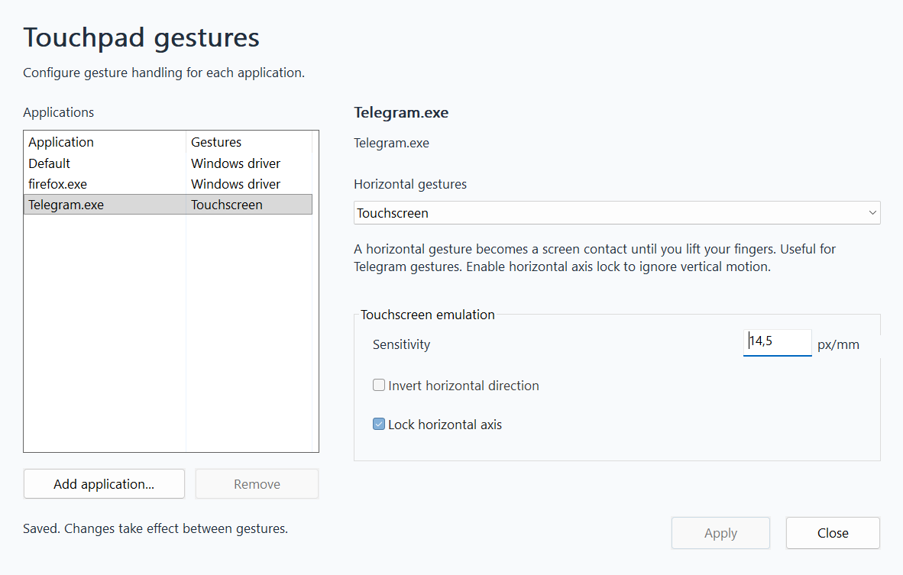

# libinput scroll for Windows ARM64

Experimental native Windows ARM64 utility for smoother two-finger scrolling, with configurable native Windows gestures and touchscreen emulation. Tested on the ASCE1200 touchpad in an ASUS Vivobook S 15 S5507QA/S5507QAD.

This is a **partial port of libinput's scrolling components**. Four upstream functions are included unchanged; HID decoding, contact tracking, Windows output, gesture routing and momentum are implemented separately. The ASUS HID/I2C driver remains installed. This project runs in user space and does not replace a kernel driver.

## Current support

| Component | Status |
| --- | --- |
| Architecture | Native ARM64 |
| Tested system | Windows 11, build 26200 |
| Tested touchpad | ASCE1200, HID VID `04F3`, PID `32E2`, 42-byte reports |
| Scrolling | Vertical and horizontal wheel output, adjustable speed and momentum |
| Cursor, clicks, pinch, three/four fingers | Existing Windows processing |
| Horizontal gestures | Per-application Windows driver / Touchscreen / No gestures |
| Other hardware | Unvalidated; the runtime rejects unsupported devices |

The runtime requires Windows support for `SPI_GETTOUCHPADPARAMETERS` and `SPI_SETTOUCHPADPARAMETERS`. Compatibility with every Windows 11 build has not been established.

## Build and run

Install Visual Studio C++ tools with ARM64 libraries, a Windows SDK with ARM64 tools/libraries, and LLVM at `C:\Program Files\LLVM`. Then run in PowerShell:

```powershell
git clone https://github.com/sr-tream/libinput-windows-arm64.git
cd libinput-windows-arm64
.\build.ps1
Copy-Item .\gestures.example.ini .\gestures.ini
.\libinput-scroll.exe --supervise
```

Copy the example only on the first run. Existing `gestures.ini` contains your preferences. Keep an external mouse available for an initial hardware test. The launcher requests UAC so wheel injection also reaches administrator windows.

Stop and restore native scrolling with **Ctrl+Alt+F12**, `Stop.cmd`, or the tray menu. A separate watchdog restores the previous native panning setting if the worker exits unexpectedly. Double-click the tray icon or run `Settings.cmd` to open settings; running the EXE without arguments opens settings too.

The application interface and documentation are in English.



To enable login startup:

```powershell
.\Enable-Autostart.ps1 -StartNow
```

See [installation and removal](docs/INSTALLATION.md) for requirements, elevation, moving the installation and recovery.

## Gesture modes

| Mode | Behavior |
| --- | --- |
| **Windows driver** | Hands an early horizontal gesture to Windows. Default mode; useful for browser back/forward gestures. |
| **Touchscreen** | Converts a horizontal two-finger gesture to one captured screen contact, useful in Telegram. Sensitivity, horizontal reversal and horizontal axis lock are configurable. |
| **No gestures** | Uses the utility's own horizontal/vertical wheel scrolling and momentum. |

Ordinary vertical scrolling uses the wheel backend. Once a gesture becomes a screen contact, its subsequent vertical component also belongs to that contact unless horizontal axis lock is enabled. Screen-contact inertia is handled by the application; this utility does not add its own touchscreen inertia.

Initial rules select Windows driver for Firefox, Touchscreen for Telegram, and Windows driver for other applications. Saved changes take effect after all fingers leave the touchpad. Scroll speed and momentum settings remain in `settings.ini`.

## Documentation

- [Installation, startup and removal](docs/INSTALLATION.md)
- [Application rules and scrolling settings](docs/CONFIGURATION.md)
- [Architecture and upstream code](docs/ARCHITECTURE.md)
- [Building, testing and device support](docs/DEVELOPMENT.md)
- [Known limitations and troubleshooting](docs/TROUBLESHOOTING.md)
- [Contributing](CONTRIBUTING.md)

The repository contains source and icon assets under the [MIT license](LICENSE). Build outputs, driver backups, raw recordings and local machine configuration are excluded. See [third-party notices](NOTICE.md) for upstream provenance.
