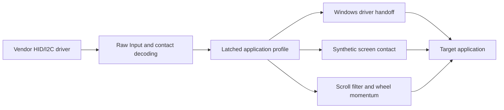

# Architecture

## Input and output

The original vendor driver provides the Precision Touchpad HID device. `touchpad.cpp` discovers its descriptor with SetupAPI/HID APIs and receives reports through Raw Input. The runtime validates the descriptor, converts coordinates to millimeters, and passes trusted contacts to the scrolling and gesture logic.

The worker temporarily controls the global native panning flag through `SPI_SETTOUCHPADPARAMETERS`. The wheel route keeps it disabled. The Windows driver route enables it for an early horizontal gesture and disables it again after every finger lifts. This setting affects the touchpad session globally; it is why ambiguous multiple-touchpad setups are rejected.

`ScrollProcessor` feeds unchanged libinput scrolling functions through a small compatibility layer. `WheelAccumulator` converts deltas into Windows wheel units. `MomentumScroll` estimates release velocity and emits decaying deltas through a high-resolution waitable timer. `SendInput` delivers vertical/horizontal wheel events.

## Gesture ownership

`gesture_handoff.h` implements Windows driver mode. It chooses an owner at the original early threshold and retains that owner until all fingers lift, including a two-to-one-finger transition. A short vertical beginning can therefore prevent a later horizontal navigation gesture.

`touchscreen_handoff.h` permits a bounded reconsideration after a short vertical or diagonal start. Eligibility closes after established vertical travel, path length or more than three wheel-output frames. A sufficiently aligned lateral segment starts a synthetic contact. Clicks, extra fingers, pinches and contact replacement block reinterpretation.

`touchscreen_output.h` maintains one `PT_TOUCH` contact. Its coordinates follow the two-finger centroid and remain within the original client bounds. Foreground changes and real clicks cancel it; hover popups do not release an already captured contact. An unsuccessful release destroys the synthetic pointer device so the contact cannot remain held indefinitely.

Windows can promote a screen contact to mouse input. The cancellation observer ignores a matching null-device touch-promoted left-button echo only while this utility owns an active screen contact. Hardware mouse buttons and untagged touchpad taps still cancel it. Windows may also move or hide the visible cursor as part of touch processing.

## Process and thread boundaries

| Component | Responsibility |
| --- | --- |
| Supervisor | Runs elevated in the interactive session; starts/restarts the worker after recoverable device or suspend events. |
| Worker | Owns Raw Input, wheel output, gesture routing, timers and the tray icon. |
| Watchdog | Restores the original panning flag if the worker exits unexpectedly. |
| Settings process | Displays the English UI, picks executables and saves preferences. |
| Profile background thread | Reloads the INI and caches destination-window executable profiles. |

File reading and application discovery stay outside the HID event path. A newly encountered window can require one limited process-path query when a gesture starts. There are no UI Automation provider queries or synchronous mouse hooks.

Profile snapshots are immutable and published atomically. The worker latches one profile per gesture. A user-scoped, medium-integrity event wakes the profile thread after a save; periodic file checks also detect edits. This event carries no arbitrary command or executable path.

## Cancellation and recovery

Raw mouse button notifications include physical buttons and untagged tap-to-click events. An out-of-context foreground WinEvent and a destination check before each inertia tick prevent old wheel momentum from reaching a new window. Cursor movement inside the same destination preserves momentum.

Stop notifications use a user-scoped event accessible to the ordinary settings/stop process and the elevated worker. Panning changes are session-only. The worker restores the original value during cleanup, while the separate watchdog covers unexpected termination.

## Upstream scope

Only four libinput functions are included: `touchpad_constant_filter`, `xy_get_direction`, `tp_gesture_same_directions`, and `tp_gesture_apply_scroll_constraints`. Their bodies are unchanged. Contact classification, pointer acceleration, palm rejection, the full libinput gesture state machine and Linux event-device integration are not ported. See [NOTICE.md](../NOTICE.md) for the pinned version and licenses.
